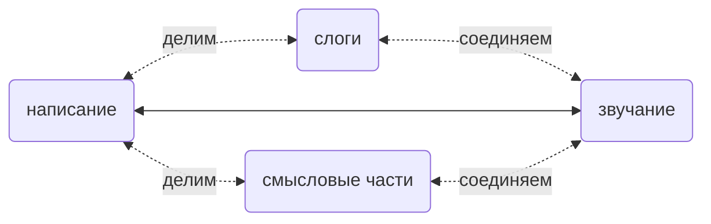

# 6.1. Как запоминать слова

В главе 3 «Звуки подробно» в каждом разделе для каждого звука перечислены «частые написания» — это и есть самое действенное подспорье для памяти, когда будете пополнять словарный запас.

Английские слова строятся главным образом двумя способами: «по звучанию» и «по смыслу».

*apple* ˈæp.əl — слово, построенное по звучанию. В нём два слога: app соответствует первому слогу ˈæp, le — второму əl. Поэтому запоминают его не по буквам: «*a, p, p, l, e… apple!*», а так: æ соответствует *a*; p пишется двойным *pp*; затем *le* читается как əl — такое написание встречается часто, например *double*, *impossible*…

А в слове *impossible* ɪmˈpɑː.sə.bəl есть часть, построенная по смыслу: *im*- — частая приставка (prefix), как *un*- и *ir*-, с отрицательным значением; *possible* — «возможный», *impossible* — «невозможный». А *possible* ˈpɑː.sə.bəl можно целиком считать словом, построенным по звучанию: *po* читается как ˈpɑː, или наоборот, ˈpɑː пишется как *po*; *ssi* ⭤ sə, *ble* ⭤ bəl… Но уж точно не «*p, o, s, s, i, b, l, e… possible!*»… Тупо запоминать 8 букв по порядку явно труднее, чем «запомнить всего три слога»; здесь нужно лишь обратить внимание на ss (double s).

Кроме того, среди частых слов немало «сложных слов» (*compound words*), и все их части тоже «смысловые». Например, *classroom* ˈklæs.ruːm , *doorbell* ˈdɔːr.bel , *handwriting* ˈhændˌraɪ.t̬ɪŋ , *sunshine* ˈsʌn.ʃaɪn , *upstairs* ʌpˈsterz  и т. п.

Корни и приставки-суффиксы, особенно латинские, пока словарный запас не достиг определённого объёма, на деле мало полезны. Но когда, скажем, запас перевалит за 5000 слов, на этой прочной основе немного изучить корни и аффиксы очень помогает быстро и сильно нарастить запас.

Например, *ichthyosaur* ˈɪk.θiə.sɔːr — видно сразу, слово нечастое, — на деле очень простое. Сначала посмотрим на звучание: ˈɪk.θi.ə.sɔːr — Кембриджский словарь делит его на 4 слога… Но на слух второй и третий слоги можно объединить: ˈɪk.θiə.sɔːr; *ich* ⭤ ˈɪk, *thyo* ⭤ θiə, *saur* ⭤ sɔːr… А по смыслу? Первая половина *ichthyo*- значит «связанный с рыбой»… А что значит вторая, -*saur*? Названия всевозможных «завров» кончаются на -*saur*, так что слово значит «ихтиозавр», то есть «рыбоящер». Русскому читателю корни здесь даже знакомы.

Самый простой и действенный способ запоминать слова — связывать его написание, звучание и значение: таково и есть изначальное устройство и смысл письма.

Кроме этого, все прочие так называемые «методы» не только бесполезны, но и дают лишь побочные эффекты — вреда от них больше, чем пользы. Например, всякие «запоминания по созвучию» или «весёлые способы запоминания»: они противоречат тому, как мозг на самом деле работает с языком и письмом, никак не повышают действенность и только добавляют лишнюю нагрузку — хотя порой и кажутся забавными…

Люди терпят неудачу по простой причине: всё хотят «чуть полегче». Сидят и смотрят только глазами — не говорят и не пишут, а значит, на деле и мозг работает меньше. Задействовать один орган и задействовать несколько сразу — не одно и то же: первое будто бы проще, но на деле мозг работает так мало, что «польза почти нулевая».

Из изучающих иностранный язык девять из десяти терпят неудачу. Многие из них когда-то спрашивали учителя: «Можно я буду учить слова без произношения?», «Можно я буду учить слова без написания?» Задавая такие нелепейшие вопросы, они хотят не ответа, а лишь «справку на лень», чтобы оправдать себя… И ведь находятся учителя, которые отвечают «можно!» — немалая доля учителей таким способом завоёвывает расположение учеников и тем увеличивает свой доход…

Поначалу запоминать слова в любом случае трудно. Это искренний совет — кто не поверит, тот прогадает, верить или нет — дело ваше:

> Ни в коем случае не пытайтесь ускориться какими-либо средствами…

— потому что на деле ускориться не может никто и никакие средства не помогут… Настоящий способ ускориться лишь один — **накопление**.

Пополнение запаса — процесс с **ускорением**: он может идти всё быстрее… Но вначале скорость мала, а ускорение равно нулю, поэтому всегда кажется ужасно трудно. Однако слова связаны между собой, и для мозга новое слово тем легче запомнить, чем больше у него связей с уже известными. То есть чем больше уже знаешь слов, тем больше связей может возникнуть у нового — и потому всё легче и легче. Когда запас перевалит за три-пять тысяч, вы почувствуете, что многие новые слова запоминаются почти с первого взгляда — и написание, и звучание, и значение, и даже употребление. Весь процесс похож на **кривую сложных процентов** с **всё нарастающим ускорением**.

Есть, правда, одна хитрость. **Учите прямо примеры-фразы**… Для мозга «прочесть фразу-пример вслух несколько раз» куда легче, чем «бросать все силы на одно слово или словосочетание». С языком так всегда: чем больше делаешь, тем легче мозгу, и наоборот — чем меньше делаешь, тем постепенно складывающаяся так называемая «экономия сил» становится для мозга непреодолимым препятствием.

А отсюда самый надёжный способ пополнять запас — **вдумчивое чтение**. Найдите книги, которые вам по-настоящему интересны (по несколько художественных и нехудожественных), встретили незнакомое слово — посмотрите в словаре, уничтожайте их одно за другим; каждую книгу прочитайте несколько раз (поэтому выбирайте книги, которыми и правда увлечены)… Читаешь, читаешь — и запас слов вырос, препятствия в строе фраз исчезли, понимание выросло, скорость чтения взлетела… Так во всех языках. Даже владение родным языком мы натренировали именно так — школьные уроки языка и учителя тут никогда особо не помогали… Скажу резкость: единственная роль этих учителей — ставить большинству учеников странные препятствия на экзаменах.